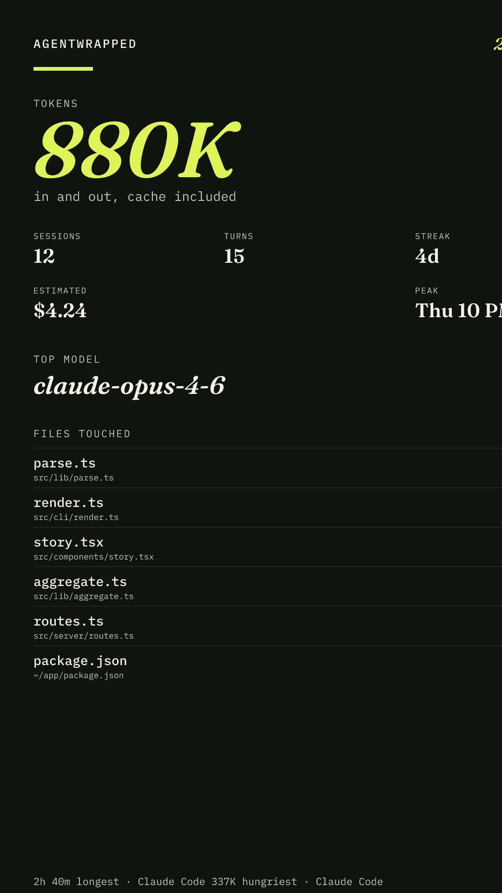
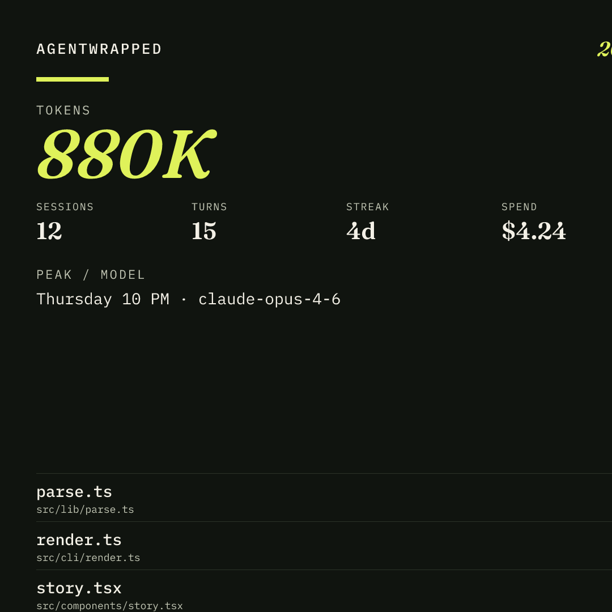

# AgentWrapped

**Spotify Wrapped for AI coding agents.** Tokens, estimated cost, hours, streaks, models, and the files they touched — read from local Claude Code and Codex CLI session logs.

Nothing is uploaded. The CLI is read-only. The only network request is `--check-update`, and that flag is off unless you pass it.

[](https://github.com/truevikas/agentwrapped/actions/workflows/ci.yml)
[](LICENSE)
[](package.json)





## Why this exists

Claude Code and the OpenAI Codex CLI already write a JSONL trail of every session: models, tokens, and files. AgentWrapped turns that trail into a year in review you can check before you trust a dashboard, and that you can share without handing over the prompts.

People look for this as Claude Code token usage, Codex CLI cost, a Spotify Wrapped for developers, or a local AI coding-agent year in review. This is that tool.

If the card is useful, star the repo so the next person searching for it can find it. Stars are how GitHub ranks a new project. They are not something this release can grant itself.

## Try the demo in under a minute

The package is not on npm yet. Clone the repo and use the bundled anonymous fixtures. They never touch your home directory.

```bash
git clone https://github.com/truevikas/agentwrapped.git
cd agentwrapped
npm install
npm run wrapped -- --demo --year 2026 --out wrapped.png --html wrapped.html
```

You get a terminal summary, `wrapped.png` (1080×1920), `wrapped-square.png` (1080×1080), and `wrapped.html`.

On a machine that actually has agent logs:

```bash
npm run wrapped -- --year 2026 --out wrapped.png --html wrapped.html --redact
```

After an npm publish, the same command will be `npx agentwrapped`. Until then, `npm run wrapped --` is the supported entry.

## What it counts

- Sessions, turns, tokens in and out
- Estimated spend from the shipped price table (an estimate, not an invoice)
- Busiest hour and weekday, in your local timezone
- Top 10 edited files, by basename and a short path
- Top models
- Longest session, and the session that spent the most tokens
- Streak: consecutive days with at least one session

`--redact` rewrites your home directory, `/Users/<name>`, and `/home/<name>` to `~` on the card, the HTML page, and JSON labels. Share the PNG, not the raw logs.

## Supported agents

| Agent | Where the logs live |
| --- | --- |
| Claude Code | `$CLAUDE_CONFIG_DIR` or `~/.claude/projects/<encoded-path>/<session-id>.jsonl`. Also `~/.claude/sessions/**/*.jsonl` and `./.claude/**/*.jsonl` when those folders exist. |
| Codex CLI | `$CODEX_HOME` (comma-separated) or `~/.codex/sessions/YYYY/MM/DD/rollout-*.jsonl`, plus `~/.codex/archived_sessions/**/*.jsonl`. `codex exec --json` transcripts are parsed too. |

Override a root with `--claude-dir` or `--codex-dir` (repeatable). If one agent's logs are missing, AgentWrapped warns and continues. The exit code stays 0.

Cursor, Copilot, Aider, and other agents are not parsed yet. An adapter is a small pure function over JSONL. See [CONTRIBUTING.md](CONTRIBUTING.md).

## Privacy

Logs never leave your machine. AgentWrapped does not upload transcripts, call a model, or collect telemetry.

The browser story in this repo is a demo of the same anonymous 2026 fixtures. It does not read Claude or Codex logs from the visitor's computer. Use the CLI for a real year.

Fixtures, docs, and the sample cards use stand-in paths under `/home/dev`. They are not a real user.

Details and how to report a vulnerability: [SECURITY.md](SECURITY.md).

## Command reference

```text
agentwrapped [options]

--year 2026              Calendar year (default: this year, local time)
--from 2026-01-01        Start date or timestamp (overrides --year)
--to 2026-06-30          End date or timestamp, inclusive
--agents claude,codex    Comma list (default: both)
--out wrapped.png        Portrait card, 1080×1920
--square card.png        Square card, 1080×1080
--html wrapped.html      Self-contained HTML summary
--json                   Machine-readable stats on stdout
--no-cost                Skip dollar estimates
--redact                 Strip home directories and usernames from labels
--prices ./prices.yaml   JSON or YAML price table
--claude-dir <path>      Claude config root or a folder of JSONL (repeatable)
--codex-dir <path>       Codex home or a folder of JSONL (repeatable)
--demo                   Bundled anonymous fixtures, no home directory
--check-update           Optional npm version lookup (off by default)
--help
```

### Examples people actually run

```bash
# Claude Code only, this calendar year, no dollar figures
npm run wrapped -- --agents claude --no-cost --json

# First half of 2026, both agents, redacted card
npm run wrapped -- --from 2026-01-01 --to 2026-06-30 --redact --out h1.png

# Point at a copied log folder instead of ~/.claude
npm run wrapped -- --claude-dir ./logs/claude --year 2026
```

## Price table

Defaults live in [`src/lib/wrapped/default-prices.json`](src/lib/wrapped/default-prices.json). Rates are USD per million tokens. The longest matching `match` substring wins, so `gpt-5.4-mini` stays more specific than `gpt-5.4`.

Copy [`prices.example.yaml`](prices.example.yaml) and pass it:

```bash
npm run wrapped -- --year 2026 --prices ./prices.yaml
```

`--no-cost` skips dollars entirely.

## Web story

`npm run dev` opens an interactive recap of the demo year: story slides, a share card, Claude / Codex toggles, and a redact switch. Arrow keys or the on-screen controls move between slides. This view is for the fixtures. Your real year comes from the CLI.

## Develop

Node 20 or newer. Node 22 is what CI uses.

```bash
npm test
npm run typecheck
```

`npm test` covers the parsers, aggregation, card path, and CLI. The card renderer is [`src/cli/render.ts`](src/cli/render.ts) (satori + resvg). Keep type inside the portrait and square frames. Do not add other product logos.

To add an agent, follow [CONTRIBUTING.md](CONTRIBUTING.md). History of the project is in [CHANGELOG.md](CHANGELOG.md).

## FAQ

### Where does Claude Code store session logs?

In `$CLAUDE_CONFIG_DIR` when that variable is set, otherwise `~/.claude/projects/**/*.jsonl`. AgentWrapped also reads `~/.claude/sessions/**/*.jsonl` and `./.claude/**/*.jsonl` when those directories exist.

### Where does the Codex CLI store session logs?

In `$CODEX_HOME` (a single path or a comma-separated list), otherwise `~/.codex/sessions/YYYY/MM/DD/rollout-*.jsonl`, plus `~/.codex/archived_sessions/**/*.jsonl`.

### Does this upload my prompts?

No. Parsing, aggregation, and card rendering all happen on the machine where you run the command. Do not commit the PNG if the paths on it are still sensitive. Pass `--redact` first.

### Is the dollar amount my bill?

No. It is a local estimate from a price table you can replace. Cache reads and cache writes are priced when the log line reports them. Providers change rates. Your invoice wins.

### Can I run it on a date range instead of a calendar year?

Yes. `--from` and `--to` override `--year`. Dates are interpreted in the machine's local timezone. `--to` is inclusive.

### What if one agent has no logs?

You get a warning on stderr and a year built from the agent that does have logs. The process still exits 0. An unknown name in `--agents` exits 1.

## Sharing the card

Post the PNG, not the JSONL. A useful caption is specific and short:

> My 2026 AgentWrapped. Claude Code and Codex, counted locally from session logs. Tokens, cost, and the files they would not leave alone.
> https://github.com/truevikas/agentwrapped

That link, plus a star, is what makes the project findable for the next search for "Claude Code wrapped" or "Codex token usage".

## License

[MIT](LICENSE) © 2026 AgentWrapped contributors
